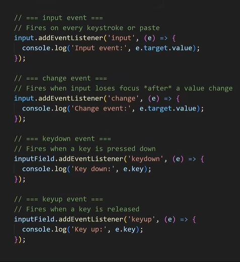

# Dom-Fundamentals

1. select HTML Element Internals
2. Update text and HTML
3. Change styles with JS
4. Edit element attributes
5. Event driven Programming 

## Example 
```html
<!DOCTYPE html>
<html lang="en">
<head>
  <meta charset="UTF-8">
  <meta name="viewport" content="width=device-width, initial-scale=1.0">
  <title>Document</title>
  <style>
    button,input,img{
      display: block;
    }
  </style>
</head>
<body>
  <h1 id="myHeading">Hello World</h1>
  <button id="myButton">Click me</button>
  <input type="text" class="myInput">
  

  <script>
    const myHeading = document.getElementById("myHeading");
    myHeading.innerText = "Hello"
    myHeading.style.backgroundColor = "green";

    const myButton = document.querySelector("Button")
    myButton.style.color = "Green"
    myButton.addEventListener("click",function(){
      alert("Button clicked");
    })

    const myInput = document.querySelector(".myInput");
    myInput.addEventListener("input", ()=>myHeading.innerText = myInput.value)

    myInput.addEventListener("keydown", function(e){
      if(e.key === "Enter"){
        myHeading.style.backgroundColor = myInput.value;
      }})

     
  </script>
</body>
</html>
```
